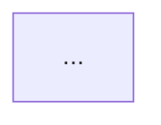

# System Prompt Analysis Framework

## Analysis Dimensions

### 1. Complexity Metrics (from script)

Interpret the quantitative report:

- **Token budget**: What % of a typical context window does this prompt consume? (8K context: <5% is lean, 5-15% is moderate, >15% is heavy)
- **Directive density**: >3 directives per 100 words suggests high constraint pressure; <1 suggests loose guidance
- **Constraint lines**: Lines starting with `- You MUST/SHOULD/MAY` — the actionable instruction count

### 2. Cognitive Load Assessment

For each section, assess:

| Load level | Indicators |
|-----------|-----------|
| **Low** | Procedural steps, single tool calls, no conditional logic |
| **Medium** | Parameter mapping, conditional branches, 2-3 things to track |
| **High** | Multi-criteria judgment calls, cross-referencing prior outputs, maintaining provenance |
| **Extreme** | Simultaneous constraint satisfaction (>30 directives), format + content + integrity rules at once |

### 3. Linearity vs Cross-Reference Reasoning

Classify the execution model:

- **Linear pipeline**: Each step uses only its own inputs; no need to carry state forward
- **Accumulating pipeline**: Each step adds to a growing context (e.g., ref values, collected data); later steps reference earlier outputs by convention
- **Provenance-tracked pipeline**: Later steps must know *which earlier step* produced each piece of data (e.g., "use [judgement:] for database results but [url:] for web results")
- **Graph execution**: Steps have bidirectional dependencies or conditional loops

Look for: forward references ("identified in Step N"), data that must be carried across steps, format decisions that depend on data source.

**Dependency map:** Create a Mermaid flowchart (`flowchart TD`) where each node is a step/section of the prompt and each edge represents a data dependency. Label edges with what data flows (e.g., "ref values", "filtered list", "quality scores"). This makes cross-reference chains and bottleneck steps immediately visible.

### 4. Redundancy Assessment

Interpret the redundancy report. Distinguish:

- **Intentional reinforcement**: Core safety constraints repeated at the point of use (may be justified if violation is catastrophic)
- **Copy-paste drift**: Same instruction with minor wording variations across sections (wasteful, can diverge over time)
- **Structural redundancy**: Information repeated in constraints, examples, AND troubleshooting (consolidate into one canonical location)

For each redundancy group, decide: consolidate into a single "golden rule" referenced throughout, OR keep selective repetition at 2-3 critical points maximum.

### 5. Restructuring Opportunities

Look for these patterns:

- **Overloaded sections**: Any section with >25 directives should be split
- **Mixed concerns**: A section mixing "what to do" with "how to format" — split into content selection vs presentation
- **Misplaced constraints**: A constraint in step N that only applies at step M (move it)
- **Inline reference material**: Large code examples, tables, or format specs embedded in step instructions (move to examples/appendix)
- **Golden rule candidates**: Constraints appearing 3+ times across sections (extract to a preamble)

### 6. Sub-Agent Decomposition Analysis

Identify natural boundaries by looking for:

- **Context independence**: Can a step run without the full prior context? (good split point)
- **Tool grouping**: Steps that use the same tools form a natural agent
- **Cognitive type**: Separate procedural (tool calls) from analytical (quality checks) from creative (synthesis)
- **Context window relief**: If the full prompt is >10K tokens, splitting means each sub-agent sees only its relevant constraints

For each proposed sub-agent, estimate:
- How many directives it carries
- What data it needs from prior agents (the handoff contract)
- Whether it benefits from extended thinking / reasoning tokens

**Decomposition diagram:** Create a Mermaid flowchart (`flowchart TD`) with each proposed sub-agent as a `subgraph` containing its steps. Draw edges between subgraphs labeled with the handoff data contract (what the upstream agent passes to the downstream agent).

### 7. Reasoning Token Recommendations

Reasoning tokens (extended thinking) are most valuable for:

- **Multi-criteria evaluation**: Steps where the agent must weigh conflicting factors (e.g., relevance filtering, quality assessment)
- **Cross-referencing**: Steps that must verify consistency across many data points
- **Judgment calls**: Steps where the right answer depends on domain expertise and nuanced interpretation
- **Creative synthesis**: Steps that must produce coherent output integrating many sources

Reasoning tokens are least valuable for:
- Procedural tool calls with fixed parameters
- Simple extraction or formatting
- Pattern matching with explicit rules

## Output Template

Use this structure for the final analysis report:

```markdown
# System Prompt Analysis: [Name]

## Executive Summary
[2-3 sentences: overall complexity verdict, biggest concern, top recommendation]

## Quantitative Profile
[Paste script output or summarize key metrics]

## Cognitive Load Map
[Table: section | directives | cognitive load level | key challenge]

## Execution Model
[Linear / Accumulating / Provenance-tracked / Graph — with explanation]

### Dependency Map
[Mermaid flowchart showing which steps consume outputs from which earlier steps.
 Nodes = steps/sections, edges = data dependencies labeled with what flows between them.]



## Redundancy & Consolidation
[List redundancy groups with recommendation: consolidate / keep / reduce]

## Restructuring Recommendations
[Numbered list of specific changes, ordered by impact]

## Sub-Agent Decomposition
[Table: sub-agent | steps | constraints | context needs | reasoning tokens?]
[Describe the handoff contract between agents]

### Decomposition Diagram
[Mermaid flowchart showing proposed sub-agents as subgraphs containing their steps,
 with edges between subgraphs showing handoff data contracts.]


## Reasoning Token Strategy
[Table: step/phase | reasoning value (High/Medium/Low) | justification]
```
